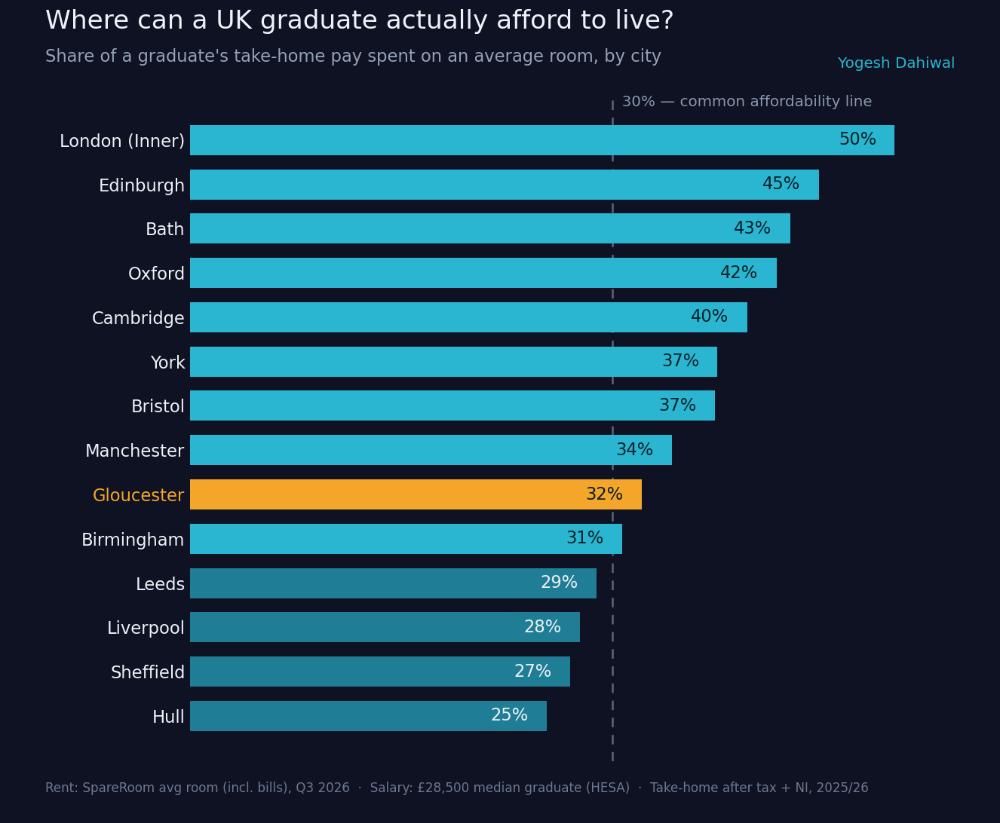

# Where can a UK graduate actually afford to live?

Quick look at how much of a typical UK graduate's take-home pay gets eaten up
by renting a room, city by city.



## Why

Everyone says "move to the big city for your career", but on a graduate
salary a lot of those cities just aren't affordable. Wanted to see the actual
numbers instead of guessing.

## Method

1. **Salary** — started from the median UK graduate salary of **£28,500**
   (HESA Graduate Outcomes, 2022/23 cohort, 15 months after graduating).
2. **Take-home pay** — calculated net monthly pay after **Income Tax + National
   Insurance** using 2025/26 England bands → about **£2,003/month**.
3. **Rent** — used the **average monthly room rent (bills included)** for 14 UK
   cities from the SpareRoom Rental Index, Q3 2026.
4. **Affordability** — expressed rent as a percentage of take-home pay, and
   flagged the common **30%** rule of thumb (rent shouldn't exceed ~30% of income).

## Key findings

| City | Rent as % of take-home pay |
|---|---|
| London (Inner) | 50% |
| Edinburgh | 45% |
| Bath | 43% |
| Oxford | 42% |
| Cambridge | 40% |
| York | 37% |
| Bristol | 37% |
| Manchester | 34% |
| Gloucester | 32% |
| Birmingham | 31% |
| Leeds | 29% |
| Liverpool | 28% |
| Sheffield | 27% |
| Hull | 25% |

- In **Inner London**, rent alone eats **half** of a graduate's take-home pay.
- Most of the UK's "big name" cities sit **above the 30% affordability line**.
- The cheapest cities (Hull, Sheffield, Liverpool) cost around **half** of
  London for the **same salary**.

## Run it yourself

```bash
pip install matplotlib
python analysis.py
```

This prints the take-home-pay breakdown and the per-city percentages, and
regenerates `chart.png`.

## Caveats

- Uses a single median salary across all cities (real salaries vary by region).
- Room rents, not whole-flat rents; "bills included" figures.
- Simplified tax model (Income Tax + NI only; no student loan repayments,
  pension, or Scottish tax bands for Edinburgh).

It's a rough model — but the gap between cities is large enough that the overall
story holds.

## Sources

- Rent: [SpareRoom — Average rent in UK top cities](https://www.spareroom.co.uk/content/info-landlords/average-rent-uk-top-cities/) (Q3 2026)
- Salary: [UK graduate starting salary statistics (HESA)](https://salarytax.uk/statistics/graduate-starting-salary-uk)
- Tax bands: UK Income Tax & National Insurance, 2025/26

---

*Built by [Yogesh Dahiwal](https://www.linkedin.com/in/yogesh-dahiwal-145b2a245) · [Portfolio](https://yogesh-dahiwal.netlify.app)*
